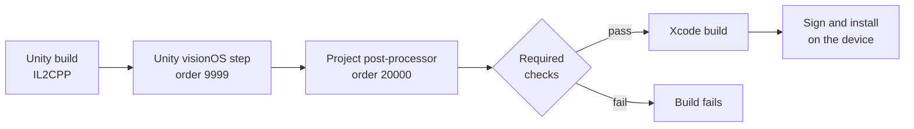

# Automotive XR on Apple Vision Pro

An in-house application for reviewing vehicles at full scale on Apple Vision Pro: you sit in a vehicle, operate it with your hands and compare variants, with everything rendered on the device.

I joined in October 2025 and continued the application from an earlier research prototype, working across the platform, rendering, interaction and release engineering. This page covers the problems where visionOS, PolySpatial and RealityKit pushed back, and how I solved them.

| Role | Platform | Stack | Since |
|---|---|---|---|
| XR engineer | Apple Vision Pro, visionOS, Unity 6.3 LTS, PolySpatial / RealityKit | C#, Shader Graph, MaterialX, Xcode, Python | October 2025 |

**In numbers**

- an existing codebase of about 20,000 lines of project C# in 200+ files, migrated to Unity 6.3 LTS and PolySpatial 3;
- 0 of 90 head positions clipped in a HUD sweep across both front seats (Editor);
- 0 Xcode errors on a fresh export (1,284 IL2CPP units, Swift and linking) after fixing a build-callback ordering bug;
- 87 packages pinned, and build warnings cut from 395 to 52, none of them in project code;
- 44 automated hand-interaction checks with simulated palms, which caught a pose-ordering bug before any headset test.

## Rendering

### Stereo mirrors without planar reflections

RealityKit has no planar reflections, and a mirror has to hold still while the head moves. Each mirror renders from the eye's reflected position through the outline of the physical mirror: an off-axis frustum per eye, based on the head pose and an assumed eye distance, with the shader picking the image for each eye. Clip planes apply to the capture only, at most one mirror re-renders per frame, and the material reaches RealityKit as PBR through MaterialX.

*Status: verified in the Editor across 27 off-axis views; working on the headset, with tuning still in progress.*

### Ordering the transparent pass

RealityKit draws the members of a sorting group in its transparent pass. On the headset this showed up as a HUD jumping in front of the windshield, glass turning see-through and UI text vanishing. The fix was a rule instead of per-object tweaks: every transparent or UI element in front of an opaque member joins the group, with one documented exception. The display canvas stays outside the group, which brought its text back at the cost of occlusion against the group, and the group went from 22 members to 15.

*Status: approved in my check on the headset.*

### View-dependent HUD clipping

In the vehicle, the windshield HUD is a reflection: a display in the dashboard projects onto the glass, and the driver sees a virtual image behind it.

In mixed reality the HUD sits at the position of that virtual image, and the application's HUD shader clips it per pixel with a ray from the eye against the visible area of the glass. Parallax made the clipping differ from seat to seat. I widened the boundary to cover the offset between the glass and the virtual image, and the glass parameters are now re-sent whenever the vehicle moves.

*Status: verified in the Editor with a sweep of 90 head positions across both front seats, with lateral, vertical and fore-aft offsets: none clipped. One edge case remains: from some head positions the HUD draws over the edge of the dashboard.*

### Lighting within RealityKit's limits

There is no post-processing on this path, and emissive surfaces light nothing. The image-based lighting of the 360° environment now reaches a receiver on the parent of all vehicles; before, it never lit the vehicle at all. Room-light weights follow the selected environment, and dynamic lights are budgeted per lighting mode, compared A/B on the headset.

## Interaction

### Hand tracking as an input device

Doors, the steering wheel and the steering column are driven directly by tracked hands, and the same parts are also animated. Hand input and the Animator therefore share transforms: control passes between them in `LateUpdate`, and an animation resumes from the part's current pose instead of snapping back. The wheel turns by the averaged rotation of one or two hands.

On visionOS, looking and pinching also clicks UI, and hand zones are large, so intent has to be explicit:

- the steering column locks on a pinch (under 1.5 cm, held for 0.08 s), and its pose is restored to where it was 0.12 s before the pinch, so the gesture itself does not move it;
- the lock re-arms only after both hands open, and a UI click cannot undo it;
- from inside the vehicle, a door unlatches only on a pinch, because an earlier attention-cone and dwell check still let open-hand pushes through.

*Status: wheel and door logic verified in the Editor with simulated palms in 44 and then 28 automated checks, which found a pose-ordering bug and a one-second button delay. Pinches cannot be simulated in the Editor; the pinch gestures are next to be checked on the headset.*

### Physics under spatial input

Props can be grabbed with a direct or an indirect pinch, and exactly one touch owns an object at a time. Release velocity is filtered and extreme impulses are clamped, so a tracking spike does not launch anything; lost input releases safely, and thrown props return. Collision uses 30 fitted primitives in place of 138,254 triangles of unneeded CAD colliders (four mesh colliders remain), on a layer that PolySpatial does not sync, so the primitives never become look-and-pinch targets.

*Status: grabbing approved in my check on the headset; colliders verified in the Editor.*

## Platform and release engineering

### Engine migration

Moving from Unity 6.0 to 6.3 LTS and from PolySpatial 2 to 3, the application crashed with SIGABRT as the main scene loaded. I traced the crash to six multisampled render textures, isolated a compile error that forced the Editor into Safe Mode, and pinned 87 package versions so that every machine resolves the same build. Build warnings fell from 395 to 52, none of them in project code.

### A build-callback ordering bug

Fresh visionOS exports stopped compiling Swift. The cause was ordering: the project's build post-processor ran at callback order 1000 and renamed the Xcode project before Unity's own visionOS step, at order 9999, had run. It now runs at order 20000 and fails the build when a required check fails. Around it sit a batch release entry point, date-based build numbers, a pre-build check and a guard for a sample plugin that broke linking.

*Status: a fresh export builds in Xcode with 0 errors (1,284 IL2CPP units, Swift and linking); signed builds installed on the device; a release build compared file by file with the previous accepted one.*

## Architecture exploration

The application keeps every vehicle in one scene and hides the inactive ones, so each new vehicle means a scene change, and a hidden vehicle still occupies memory. I wrote a proposal to separate the player from the content and built a native Swift and RealityKit prototype to test the package concept:

- one player application for all vehicles;
- vehicles delivered as versioned packages: an engine-neutral manifest, an engine-specific payload, checksummed media, a validation report and stable IDs for interactive parts;
- publishing from Blender by designers, without changes to the application;
- a closed material library in the player, with packages referencing materials and parameters only;
- one vehicle in memory at a time.

*Status: an exploration, a proposal and a prototype.*

## How I work

I own the architecture, the requirements and the acceptance criteria. I build with AI coding tools, review and integrate every change myself, tune the scenes and verify the result on the headset. Every result is recorded with its evidence and its level (verified in the Editor, approved on the headset or reported).

## Related

- [Automotive content pipeline](https://github.com/jacobemanuel/automotive-content-pipeline-portfolio): geometry processing on CAD surfaces, collision proxies, Blender tooling and a validating exporter.
- [receptionOS Visualizer](https://github.com/jacobemanuel/receptionos-visualizer-portfolio): a Vision Pro application for aligned 3D scans.

Images on this page are schematic illustrations created for it. They are not OEM designs and contain no vehicle data. Employer, vehicle and internal tool names are omitted.

© 2026 Jakub Majewski. Text and media: all rights reserved.
