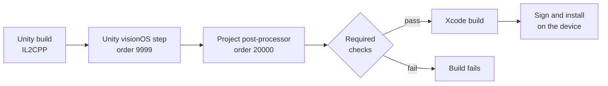

# Automotive XR

An in-house XR app for full-scale vehicle design reviews, with hand-tracked interaction, switching between variants and rendering on the device.

I joined in October 2025 and continued the app from an earlier research prototype. Since then I've worked across the platform, rendering, interaction and release engineering. This page covers the main technical problems on visionOS, PolySpatial and RealityKit and how I solved them.

| Role | Platform | Stack | Since |
|---|---|---|---|
| Software developer and project lead | Apple Vision Pro, visionOS, Unity 6.3 LTS, PolySpatial / RealityKit | C#, Shader Graph, MaterialX, Xcode, Python | October 2025 |

**In numbers**

- 0 of 90 head positions clipped in a HUD sweep across both front seats (Editor)
- 0 Xcode errors on a fresh export (1,284 IL2CPP units, Swift and linking) after fixing a build-callback ordering bug
- 87 packages pinned and build warnings cut from 395 to 52, none of them in project code
- 44 automated hand-interaction checks with simulated palms, which caught a pose-ordering bug before any headset test

## Rendering

### Stereo mirrors without planar reflections

RealityKit has no planar reflections, and the reflection has to stay stable while the head moves. So each mirror renders from the eye's reflected position through the outline of the physical mirror, with an off-axis frustum per eye based on the head pose and an assumed eye distance. The shader picks the image for each eye. Clip planes only apply to the capture, and at most one mirror re-renders per frame. The material reaches RealityKit as PBR through MaterialX.

*Status: verified in the Editor across 27 off-axis views. Working on the headset, tuning still in progress.*

### Ordering the transparent pass

RealityKit draws the members of a sorting group in its transparent pass. On the headset this showed up as a HUD jumping in front of the windshield. Glass turned see-through and UI text vanished. I fixed it with a rule instead of per-object tweaks. Every transparent or UI element in front of an opaque member joins the group, with one documented exception. The display canvas stays outside the group, which brought its text back at the cost of occlusion against the group. The group went from 22 members to 15.

*Status: approved in my check on the headset.*

### View-dependent HUD clipping

In the vehicle the windshield HUD is a reflection. A display in the dashboard projects onto the glass and the driver sees a virtual image behind it.

In mixed reality the HUD sits where that virtual image is. The app's HUD shader clips it per pixel with a ray from the eye against the visible area of the glass. Parallax made the clipping differ from seat to seat. I widened the boundary to cover the offset between the glass and the virtual image. The glass parameters now get re-sent whenever the vehicle moves.

*Status: verified in the Editor with a sweep of 90 head positions across both front seats (lateral, vertical and fore-aft offsets). None of them clipped. There's still one edge case. From some head positions the HUD draws over the edge of the dashboard.*

### Lighting within RealityKit's limits

There's no post-processing on this path. Emissive surfaces don't light anything either. The image-based lighting of the 360° environment now reaches a receiver on the parent of all vehicles. Before that it never lit the vehicle at all. Room-light weights follow the selected environment. Dynamic lights are budgeted per lighting mode, compared A/B on the headset.

## Interaction

### Hand tracking as an input device

Tracked hands drive the doors, the steering wheel and the steering column directly. The same parts are also animated, so hand input and the Animator share transforms. Control passes between them in `LateUpdate`. An animation picks up from the part's current pose instead of snapping back. The wheel turns by the averaged rotation of one or two hands.

Looking and pinching also clicks UI on visionOS, and the hand zones are large. So intent has to be explicit:

- The steering column locks on a pinch (under 1.5 cm, held for 0.08 s). Its pose is restored to where it was 0.12 s before the pinch, so the gesture itself doesn't move it. The lock only re-arms after both hands open, and a UI click can't undo it.
- From inside the vehicle a door only unlatches on a pinch, because an earlier attention-cone and dwell check still let open-hand pushes through.

*Status: wheel and door logic verified in the Editor with simulated palms in 44 and then 28 automated checks. They found a pose-ordering bug and a one-second button delay. Pinches can't be simulated in the Editor. The pinch gestures are the next thing to check on the headset.*

### Physics under spatial input

Props can be grabbed with a direct or an indirect pinch. Exactly one touch owns an object at a time. Release velocity is filtered and extreme impulses are clamped, so a tracking spike doesn't launch anything. Lost input releases safely, and thrown props come back. Collision uses 30 fitted primitives in place of 138,254 triangles of unneeded CAD colliders (four mesh colliders remain). It sits on a layer that PolySpatial doesn't sync, so the primitives never become look-and-pinch targets.

*Status: grabbing approved in my check on the headset. Colliders verified in the Editor.*

## Platform and release engineering

### Engine migration

After the move from Unity 6.0 to 6.3 LTS and from PolySpatial 2 to 3, the app crashed with SIGABRT as the main scene loaded. I traced the crash to six multisampled render textures and isolated a compile error that forced the Editor into Safe Mode. I also pinned 87 package versions so every machine resolves the same build. Build warnings fell from 395 to 52, none of them in project code.

### A build-callback ordering bug

Fresh visionOS exports stopped compiling Swift. It turned out to be an ordering problem. The project's build post-processor ran at callback order 1000 and renamed the Xcode project before Unity's own visionOS step (order 9999) had run. It now runs at order 20000 and fails the build when a required check fails. Around it there's a batch release entry point, date-based build numbers, a pre-build check and a guard for a sample plugin that broke linking.

*Status: a fresh export builds in Xcode with 0 errors (1,284 IL2CPP units, Swift and linking). Signed builds installed on the device. A release build compared file by file with the previous accepted one.*

## Architecture exploration

The app keeps every vehicle in one scene and hides the inactive ones. So each new vehicle means a scene change, and a hidden vehicle still takes up memory. I wrote a proposal to separate the player from the content. I also built a native Swift and RealityKit prototype to test the package concept:

- one player app for all vehicles
- vehicles delivered as versioned packages: an engine-neutral manifest, an engine-specific payload, checksummed media, a validation report and stable IDs for interactive parts
- designers publish from Blender without any changes to the app
- a closed material library in the player, with packages only referencing materials and parameters
- one vehicle in memory at a time

*Status: an exploration, with a proposal and a prototype.*

## How I work

I own the architecture, the requirements and the acceptance criteria. I build with AI coding tools. I review and integrate every change myself, tune the scenes and verify the result on the headset. Every result gets recorded with its evidence and its level (verified in the Editor, approved on the headset or reported).

## Related

- [Automotive content pipeline](https://github.com/jacobemanuel/automotive-content-pipeline-portfolio): geometry processing on CAD surfaces, collision proxies, Blender tooling and a validating exporter.
- [receptionOS Visualizer](https://github.com/jacobemanuel/receptionos-visualizer-portfolio): an XR application for aligned 3D scans.

The images here are schematic illustrations made for this page. They aren't OEM designs and don't contain any vehicle data. Employer, vehicle and internal tool names are left out.

© 2026 Jakub Majewski. Text and media: all rights reserved.
