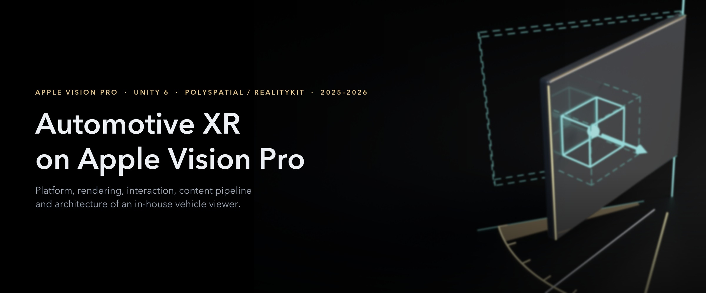
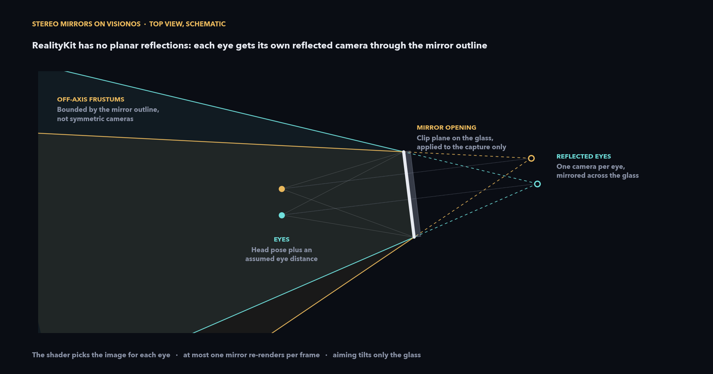
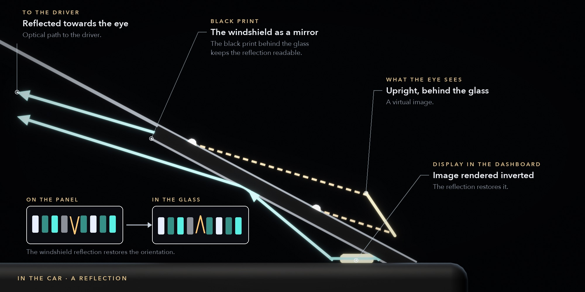
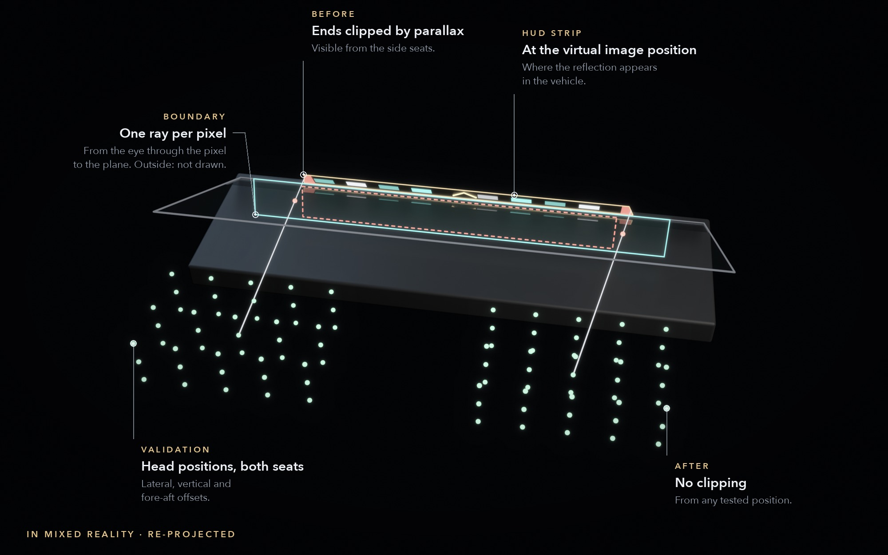
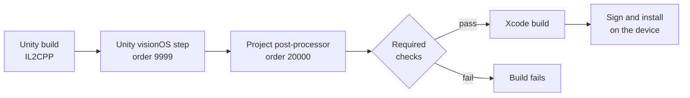
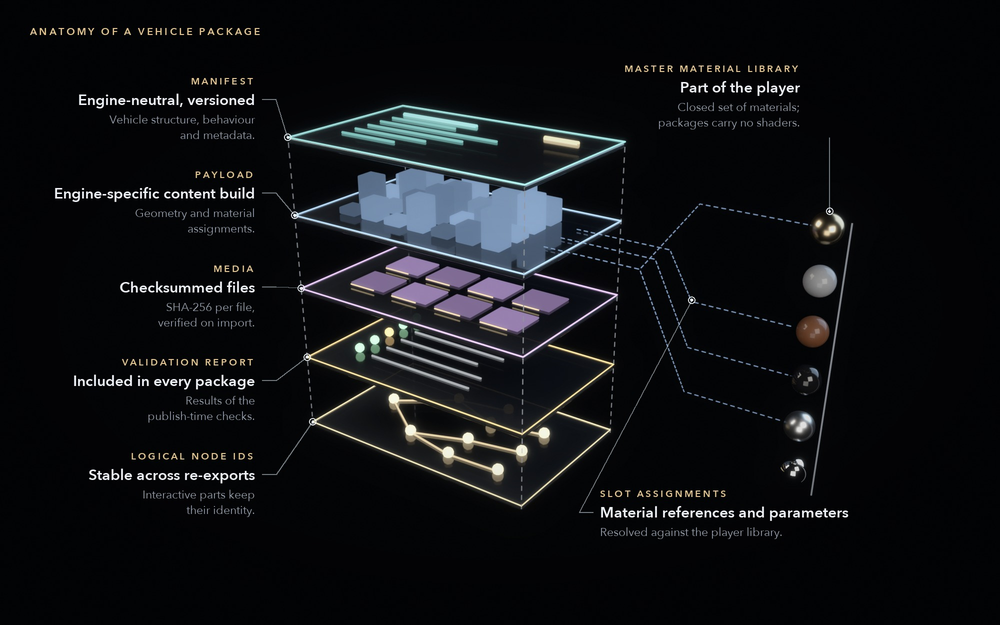

# Automotive XR

An in-house XR app for full-scale vehicle design reviews on a headset, used by designers, engineers and management.

Reviewers sit in a physical seating buck, a mock-up with real seats and a real steering wheel. The focus is the interior, from production cars to concept studies. I took the app over in October 2025, when it was still a research prototype. Since mid-2026 I own its platform, architecture and releases, working with a team of three and an external development partner.

| Role | Platform | Stack | Since |
|---|---|---|---|
| Software developer and technical lead | Apple Vision Pro, visionOS, Unity 6.3 LTS, PolySpatial / RealityKit | C#, Swift, Shader Graph, MaterialX, Xcode, Python | October 2025 |

## What the app does

- **Two ways to review.** In mixed reality the car sits on the seating buck. A printed marker at a known point places it once, then a world anchor holds it, so it doesn't jitter. With no marker in view, the car goes on the detected floor. The other way is a 360° day or night environment that hides the room and lights the car.
- **Tracked steering.** The virtual steering assembly follows the buck's real one through its own marker, every frame.
- **Variants from the driver's seat.** Seats, steering wheels, materials and about a dozen display concepts can be swapped without getting up. Switching to another vehicle keeps the doors and the wheel as they were.
- **Hands on the car.** Doors latch, swing with inertia, close softly and play sound from where they are. The steering wheel turns with one or two hands. Props can be grabbed and thrown, and they come back.

## How the year went

- **October 2025 to January 2026:** took over the research prototype, got a full vehicle running smoothly on the headset at about 1.5 million polygons, merged two parallel Unity projects into one baseline and wrote the team's version-control guide. One build went out on site for a management session, with fixes made on the spot.
- **February to June 2026:** each vehicle shipped as its own app. I made concept builds with new displays and a new steering wheel for design reviews and updated the dashboard mapping. I also brought the team's Blender add-on to Blender 4 and 5 (more in the [content pipeline](https://github.com/jacobemanuel/automotive-content-pipeline-portfolio)).
- **July 2026:** the move to Unity 6.3 LTS and PolySpatial 3, with the crash and build fixes described below.
- **August 2026:** the headset closed the app at its memory limit. I moved the project to a clean baseline with date-based build numbers.
- **September 2026:** two vehicles that can be switched from the seat, with doors and steering operated by hand, and an onboarding repository with a developer guide for an external development partner.
- **October 2026:** a full review build with materials, quilting and stitching, cabin lighting and lighter meshes (the [content pipeline](https://github.com/jacobemanuel/automotive-content-pipeline-portfolio) has the details), and release builds checked file by file against the last accepted one. Also a workshop for the team on building with AI agents, and a proposal for the next architecture with a native prototype.

## Selected technical problems

The sections below are the problems from recent months that took the most work. Most of them end with how far they've been verified.

### Stereo mirrors without planar reflections

RealityKit has no planar (mirror) reflections, and a mirror image has to stay stable while the head moves. So each mirror renders from the eye's reflected position through the outline of the mirror glass, with an off-axis frustum per eye based on the head pose and an assumed eye distance. The shader picks the image for each eye. Clip planes only apply to the capture, and at most one mirror re-renders per frame. The material reaches RealityKit as PBR through MaterialX.

*Status: verified in the Unity Editor across 27 off-axis views. It works on the headset, and tuning is still in progress.*

### Ordering the transparent pass

RealityKit draws the members of a sorting group in its transparent pass. On the headset, ordering problems there showed up as the head-up display (HUD) jumping in front of the windshield. Glass turned see-through and UI text vanished. One rule fixed all of it: every transparent or UI element in front of an opaque member joins the group, with one documented exception. The display canvas stays outside the group, which brought its text back at the cost of correct occlusion against the group. The group went from 22 members to 15.

*Status: approved on the headset.*

### View-dependent HUD clipping

In the vehicle the windshield HUD is a reflection. A display in the dashboard projects onto the glass and the driver sees a virtual image behind it.

In mixed reality the HUD sits where that virtual image is. The app's HUD shader clips it per pixel with a ray from the eye against the visible area of the glass. Parallax made the clipping differ from seat to seat. I widened the boundary to cover the offset between the glass and the virtual image, and the glass parameters now get re-sent whenever the vehicle moves.

*Status: verified in the Editor with a sweep of 90 head positions across both front seats, moving the head sideways, up and down, and forward and back. None of them cut the HUD off wrongly. One edge case is left: from some head positions the HUD draws over the edge of the dashboard.*

### Lighting within RealityKit's limits

RealityKit on this path has no post-processing, and glowing (emissive) surfaces don't light anything around them. The image-based lighting of the 360° environment now reaches a receiver on the parent of all vehicles. Before that it never lit the vehicle at all. Room-light weights follow the selected environment. Dynamic lights are budgeted per lighting mode and compared A/B on the headset.

### Hand tracking as an input device

Tracked hands drive the doors, the steering wheel and the steering column directly. The same parts are also animated, so hand input and Unity's Animator both move them. Control passes between them in `LateUpdate`, and an animation picks up from the part's current pose, so nothing snaps back. The wheel turns by the averaged rotation of one or two hands.

On visionOS, looking at a button and pinching also clicks it, and the zones where a hand counts as touching a part are large. So intent has to be explicit:

- The steering column locks on a pinch (thumb and index finger closer than 1.5 cm for 0.08 s). Its pose is restored to where it was 0.12 s before the pinch, so the gesture itself doesn't move it. The lock only re-arms after both hands open, and a UI click can't undo it.
- From inside the vehicle a door only unlatches on a pinch, because an earlier check on head direction and dwell time still let open-hand pushes through.

*Status: wheel and door logic verified in the Editor with simulated palms, in two rounds of automated checks (44, then 28). They found a pose-ordering bug and a one-second button delay. Pinches can't be simulated in the Editor, so the pinch gestures are the next thing to check on the headset.*

### Physics under spatial input

Props can be grabbed with a direct or an indirect pinch, and exactly one touch owns an object at a time. Release velocity is filtered and extreme impulses are clamped, so a tracking spike doesn't launch anything. Lost input releases safely and thrown props come back. Unneeded CAD mesh colliders (138,254 triangles) are gone, and the props collide against 30 fitted primitives, with four mesh colliders left. The primitives sit on a layer that PolySpatial doesn't sync, so they never become look-and-pinch targets.

*Status: grabbing approved on the headset. Colliders verified in the Editor.*

### Engine migration

After the move from Unity 6.0 to 6.3 LTS and from PolySpatial 2 to 3, the app crashed with SIGABRT as the main scene loaded. I traced the crash to six multisampled render textures and fixed them, and isolated a compile error that had forced the Editor into Safe Mode. I also pinned 87 package versions so every machine builds with the same packages. Build warnings fell from 395 to 52, and none of the remaining ones come from project code.

### A build-callback ordering bug

Fresh visionOS exports stopped compiling Swift. It turned out to be an ordering problem. The project's build post-processor ran at callback order 1000 and renamed the Xcode project before Unity's own visionOS step (order 9999) had run. It now runs at order 20000 and fails the build when a required check fails. Around it sit a command-line release build, date-based build numbers, a pre-build check and a guard against a sample plugin that broke linking.

*Status: a fresh export builds in Xcode with 0 errors across 1,284 IL2CPP units, the Swift code and the linking step. Signed builds installed on the headset. A release build compared file by file with the last accepted one.*

## Architecture exploration

The app keeps every vehicle in one scene and hides the inactive ones. So adding a vehicle means changing the shared scene, and a hidden vehicle still takes up memory. I wrote a proposal to separate the player app from the vehicle content and built a native Swift and RealityKit prototype to test the package idea:

- one player app for all vehicles, with one vehicle in memory at a time
- vehicles delivered as versioned packages: an engine-neutral manifest, an engine-specific payload, checksummed media, a validation report, stable IDs for interactive parts and material assignments
- designers publish from Blender without any changes to the app
- a closed material library in the player, with packages only referencing materials and parameters

*Status: an exploration, with a proposal and a prototype.*

## How I work

I own the architecture and set the requirements and acceptance criteria. I build with AI coding tools, and I review and integrate every change myself. I also tune the scenes and check every result on the headset. Each result gets recorded with its evidence and its level: verified in the Editor, approved on the headset or only reported.

## Related

- [Automotive content pipeline](https://github.com/jacobemanuel/automotive-content-pipeline-portfolio): how car interiors get from engineering CAD and reference photos into this app, with the results measured.
- [receptionOS Visualizer](https://github.com/jacobemanuel/receptionos-visualizer-portfolio): an XR app for aligned 3D scans in dental clinics.

The images here are schematic illustrations made for this page. They aren't designs from any car maker and don't contain any vehicle data. Employer, vehicle and internal tool names are left out.

© 2026 Jakub Majewski. Text and media: all rights reserved.
